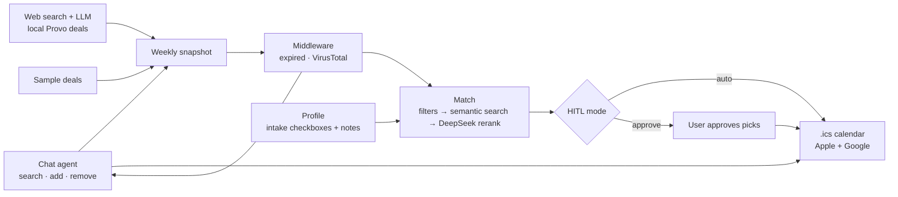

# CalenDeal Agent

Finds the deals each student would actually use (on things they already buy) and puts them on a dedicated **CalenDeal** calendar that works in **Apple Calendar and Google Calendar**, with the promo code, link, and a reminder before each deal ends. Toggle the calendar off to hide every deal at once.

**New here, or starting a Claude session?** Read [`CLAUDE.md`](CLAUDE.md), then [`docs/HANDOFF.md`](docs/HANDOFF.md).

| Doc | What's in it |
|---|---|
| [`docs/PRODUCT_SPEC.md`](docs/PRODUCT_SPEC.md) | Problem, users, what v1 does, the demo |
| [`docs/PRIORITIES.md`](docs/PRIORITIES.md) | Tier 1 / 2 / 3 backlog with status |
| [`docs/ARCHITECTURE.md`](docs/ARCHITECTURE.md) | Pipeline, modules, data model, stack |
| [`docs/DATA_SOURCES.md`](docs/DATA_SOURCES.md) | RSS/APIs + local agent search, the snapshot workflow, scraping rules |
| [`docs/GUARDRAILS.md`](docs/GUARDRAILS.md) | VirusTotal middleware, expiry, HITL, privacy |
| [`docs/EVALUATION.md`](docs/EVALUATION.md) | The 3–4 comparison runs and the metrics |
| [`docs/TEAM_WORKFLOW.md`](docs/TEAM_WORKFLOW.md) | Claim → branch → handoff → push → tell the chat |
| [`docs/DECISIONS.md`](docs/DECISIONS.md) | Decision log, open questions, ideas set aside |
| [`docs/LAB_PATTERNS.md`](docs/LAB_PATTERNS.md) | Which class lab each part of the code follows |

## How it works



v1 is built (web app, chat agent, local search). Next steps are in `docs/HANDOFF.md`.

## Quickstart

```bash
python -m venv .venv && source .venv/bin/activate   # Windows: .venv\Scripts\activate
pip install -r requirements.txt
cp .env.example .env          # add DEEPSEEK_API_KEY (agent + rerank) and VIRUSTOTAL_API_KEY (link checks); both optional

# the web app (open http://127.0.0.1:7860, use your browser's phone view for demos)
python -m app.app

# try it on the sample deals: print picks for each demo profile
python -m calendeal.main match --profile profiles/eats_out.json --sources sample --dry-run
python -m calendeal.main match --profile profiles/grocery_saver.json --sources sample --dry-run

# write a calendar file you can import into Apple/Google Calendar
python -m calendeal.main match --profile profiles/online_shopper.json --sources sample --yes --ics out/olivia.ics

# weekly "mega scrape" -> data/snapshots/<date>.json, then match against it
python -m calendeal.main snapshot --check-links
python -m calendeal.main match --profile profiles/eats_out.json --snapshot latest
```

If the sample deals have expired by the time you run this, add `--today 2026-11-22`.

### Optional: write straight to Google Calendar

`--gcal` pushes events through the Google Calendar API instead of writing an `.ics` file. Setup:

1. Google Cloud Console → new project → enable **Google Calendar API**.
2. OAuth consent screen → External → add teammates as **test users**.
3. Credentials → Create OAuth client ID → **Desktop app** → download as `credentials.json` in the repo root.
4. The first `--gcal` run opens a browser to sign in and writes `token.json`.

Both files are in `.gitignore`. Never commit them.

## Working together

Short version of [`docs/TEAM_WORKFLOW.md`](docs/TEAM_WORKFLOW.md): claim the task in the group chat, branch, run `pytest`, add a `docs/HANDOFF.md` entry, push, open a PR, and tell the chat.
