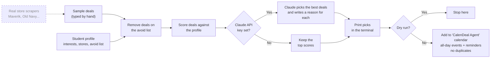

# CalenDeal Agent

Finds the deals each student cares about and adds them to a dedicated **CalenDeal** calendar in Google Calendar — toggle the calendar off to hide every deal at once, with reminders before each deal starts.

## How it works

```
Phase 1: find + match                          Phase 2: act
┌──────────┐   ┌──────────┐   ┌───────────┐    ┌──────────────────────┐
│ sources/ │──▶│ Deal     │──▶│ matcher   │──▶ │ gcal.py              │
│ scrapers │   │ objects  │   │ retrieve  │    │ "CalenDeal" calendar │
└──────────┘   └──────────┘   │ + LLM pick│    │ events + reminders   │
                              └───────────┘    └──────────────────────┘
                                    ▲
                          profiles/<user>.json
```

| File | Owner | What it does |
|---|---|---|
| `calendeal/sources/` | _tbd_ | One module per deal source. Each returns a list of `Deal`. |
| `calendeal/matcher.py` | _tbd_ | Retrieval (TF-IDF over deals vs. profile), then optional Claude rerank with a one-line "why". |
| `calendeal/gcal.py` | _tbd_ | Creates the CalenDeal calendar, adds events, dedupes, sets reminders. |
| `calendeal/main.py` | _tbd_ | CLI that runs the pipeline. |
| `profiles/*.json` | everyone | One profile per test user (interests, location, budget). |

## What works today

The dashed box isn't built yet: right now deals come from hand-entered sample data. Adding to Google Calendar works once `credentials.json` is set up (see below).



## Quickstart

```bash
python -m venv .venv && source .venv/bin/activate   # Windows: .venv\Scripts\activate
pip install -r requirements.txt
cp .env.example .env                                 # add your ANTHROPIC_API_KEY (optional)

python -m calendeal.main --profile profiles/example.json --dry-run
```

`--dry-run` prints the matched deals without touching your calendar. Drop it once Google auth is set up.

### Google Calendar setup (one person does this, shares nothing secret)

1. Google Cloud Console → new project → enable **Google Calendar API**.
2. OAuth consent screen → External → add teammates as **test users**.
3. Credentials → Create OAuth client ID → **Desktop app** → download as `credentials.json` in the repo root.
4. First real run opens a browser to sign in and writes `token.json`.

Both files are in `.gitignore` — never commit them. Each teammate can download the same `credentials.json` from the shared Cloud project (or the owner sends it privately); `token.json` is per person.

## Working together

- Branch per feature: `git checkout -b scraper-maverik`, open a PR into `main`.
- Add a new source by copying `calendeal/sources/sample.py` and registering it in `calendeal/sources/__init__.py`.
- Run tests before pushing: `pytest`

