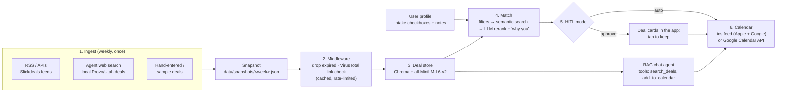

# Architecture

**One agent.** The team decided a single agent is enough; the professor said single vs. multi-agent doesn't matter. Reuse what we built in the labs (semantic search with Chroma, the RAG chatbot, middleware/HITL, Gradio) instead of starting over.

## Pipeline

## Chat agent tools

`search_deals` (RAG retrieval) · `weekly_picks` · `find_local_deals` (live web search, "look extra hard for X") · `add_to_calendar` (paused for approval in approve mode) · `remove_from_calendar` · `my_calendar`. The system prompt forbids inventing deals: it may only mention deals the tools return, by id.

## Modules

| Path | Job | Status |
|---|---|---|
| `calendeal/models.py` | `Deal` and `UserProfile`: the shared data shapes every other module uses | ✅ updated |
| `calendeal/sources/` | One module per source; each exposes `fetch() -> list[Deal]` | sample ✅, slickdeals 🟡, local_search ✅ |
| `calendeal/snapshot.py` | Runs all sources once, saves a dated JSON snapshot, and loads it back | ✅ |
| `calendeal/middleware.py` | Expiry filter + VirusTotal URL check with a cache and 4-per-minute throttle | ✅ (needs `VIRUSTOTAL_API_KEY`) |
| `calendeal/matcher.py` | Hard filters → semantic retrieval (Chroma if installed, else TF-IDF) → optional LLM rerank; `search()` for the chat agent | ✅ |
| `calendeal/llm.py` | One place to get the chat model (`init_chat_model`), DeepSeek by default; `structured()` = Pydantic + bounded retry | ✅ |
| `calendeal/store.py` | Per-user profile, calendar, dismissed deals; rebuilds the `.ics` on every change | ✅ |
| `calendeal/ics.py` | Builds a `.ics` calendar from picked deals (works with Apple, Google, Outlook) | ✅ |
| `calendeal/gcal.py` | Writes directly to Google Calendar through its API (optional path) | ✅ (existing) |
| `calendeal/main.py` | CLI: `snapshot`, `match`, `--ics`, `--gcal` | ✅ |
| `calendeal/agent.py` | RAG chat agent (LangChain `create_agent` + tools + `HumanInTheLoopMiddleware`) | ✅ v1 |
| `calendeal/sources/local_search.py` | Web search (ddgs, no key) → LLM extracts deals (Pydantic); drops deals whose URL wasn't in the results | ✅ v1 |
| `app/app.py` | Gradio web app, mobile layout: intake, weekly picks, calendar, chat | ✅ v1 |

## Data model (short version)

`Deal`: title, store, start, end (inclusive), description, category, channel (in store / online), url, location, **promo_code**, **brand**, **product_type**, source, plus `link_safe` (set by middleware) and `score`/`reason` (set by the matcher).

`UserProfile`: name, **categories** (from the checkboxes), interests (free text), stores, avoid, location, **radius_miles**, prefers_online, **brand_loyal**, **notes**, **hitl_mode** (`auto` | `approve`), max_deals_per_week.

Full definitions: `calendeal/models.py`.

## Matching, step by step

1. **Hard filters.** Drop deals that are expired, outside the profile's categories (when categories are set), on the avoid list, or flagged unsafe.
2. **Retrieve.** Embed `profile.text()` and search the deal collection (Chroma + `all-MiniLM-L6-v2`, same as Lab 1). If `chromadb`/`sentence-transformers` aren't installed, fall back to TF-IDF so tests and quick runs still work.
3. **Boosts.** Favorite stores, preferred channel, and brand-loyal products get a small score bump. Brand-loyal means: only show *that* brand for that product type.
4. **Rerank.** With an LLM key (DeepSeek by default), the model picks the final ≤ `max_deals_per_week` deals and writes a "why you" line for each, as Pydantic structured output with a bounded retry. Without a key, the top retrieval scores are kept.

## Calendar: why `.ics` is the default

One teammate uses Apple Calendar, so the Google-only API wasn't enough. An `.ics` file can be imported anywhere. Served from a URL, it becomes a **subscription**: when we regenerate the file (say, after a user swipes a deal away), every subscribed calendar updates. The Google API path (`gcal.py`) stays available for anyone who wants it.

Each event is all-day across the deal window, has a reminder before it starts, and includes the store, the "why you" line, the promo code, and the link.

## Stack

- Python 3.11+
- Embeddings and vector store: `sentence-transformers` (`all-MiniLM-L6-v2`) + `chromadb` (Lab 1)
- LLM: **DeepSeek `deepseek-flash`** via `langchain-deepseek` + `init_chat_model` (cheap: pennies per weekly run). Thinking mode off by default (see `calendeal/llm.py`). Swap to Claude or a local Ollama model with `CALENDEAL_LLM`.
- Agent and HITL: `langchain` `create_agent` + `HumanInTheLoopMiddleware` (middleware lab)
- Web UI: Gradio Blocks, mobile layout (Lab 2)
- Local search: `ddgs` (DuckDuckGo, free, no key)
- Tracing / evals: LangSmith (optional, scores well on the matrix's "feedback loop" row)
